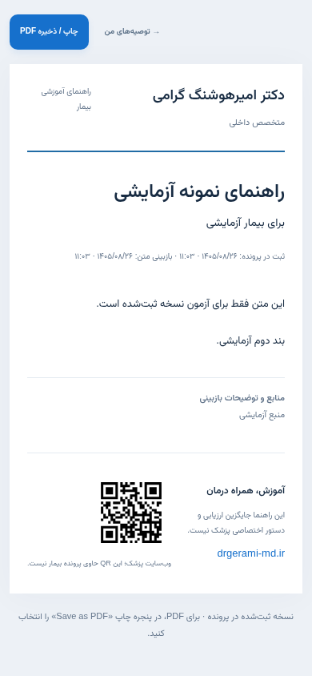
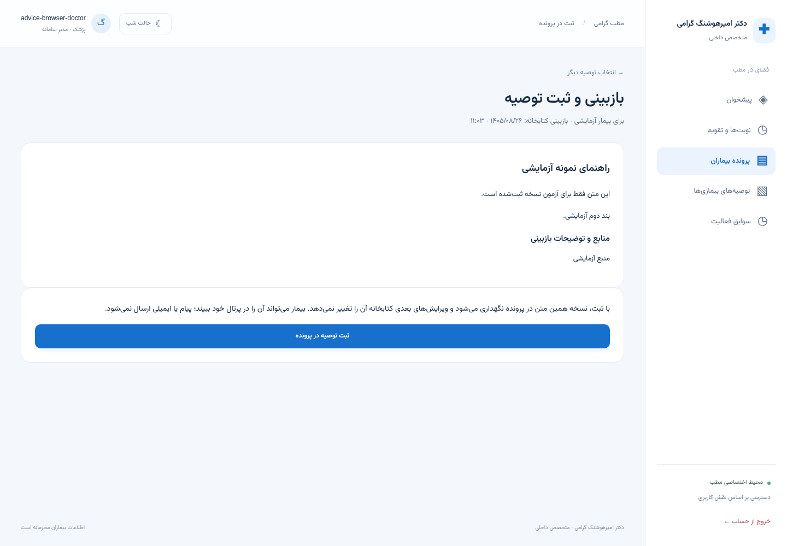

# پیش‌نمایش توسعه Clinic

تصاویر زیر از Chromium و حساب‌ها/متن‌های **کاملاً آزمایشی** ساخته شده‌اند. پیش‌نمایش وضعیت کد هستند، نه سایت مستقر، پرونده واقعی یا توصیه پزشکی معتبر. اجرای برنامه به محیط توسعه نیاز دارد؛ هاست تهیه نشده است.

## توصیه ثبت‌شده از دید بیمار — موبایل

متن زمان ثبت، حتی پس از ویرایش کتابخانه ثابت می‌ماند. بیمار فقط نسخه‌های پرونده متصل به حساب خودش را می‌بیند. QR فقط نشانی عمومی سایت پزشک است.

## بازبینی پیش از ثبت — دسکتاپ

پزشک متن کامل و بیمار مقصد را پیش از ثبت می‌بیند. ثبت در پرونده، پیام یا ایمیلی ارسال نمی‌کند.

## کتابخانه توصیه و نمونه PDF — مرحله ۸

[پیش‌نمایش زندهٔ کتابخانه](https://drgerami-md.ir/clinic/advice/) با ۲۴ پیش‌نویس در ۱۲ شاخه، جست‌وجوی فارسی/انگلیسی و انتخاب چند راهنما. اطلاعات بیمار ثابت و ساختگی است؛ ثبت یا ورود واقعی فعال نیست.

[نمونه PDF پنج‌صفحه‌ای](education-demo.pdf) شامل رفلاکس، فشار خون، دیابت و بیماری مزمن کلیه، وزیرمتن تعبیه‌شده، لوگوی واقعی سایت، سربرگ/پابرگ تکرارشونده و QR پرونده آزمایشی است. این PDF پیش‌نویس است و برای تحویل درمانی نیست. QR بسته‌های تازه در برنامه کامل به خلاصهٔ صریحاً منتشرشده پزشک می‌رود؛ فقط بیمار صاحب پرونده و پزشک پس از ورود مجازند. توضیح QR عمومی بالا مربوط به نسخه قدیمی تک‌توصیه‌ای است.

اصلاح مرحله ۹: نمونه PDF بالا اکنون بدون بخش «منابع و بازبینی» و بدون کادر بزرگ پیش‌نویس، با سربرگ/پابرگ طوسی‌سفید و عنوان‌های برجسته است. منابع در کتابخانه/بازبینی پزشک نگهداری می‌شوند. کلیک واقعی دکمهٔ چاپ و ورود از پرونده بیمار به بانک کامل نیز اصلاح و آزموده شدند.

مرحله ۱۰: فوترها از نمونه PDF و چاپ راهنماها حذف شده‌اند؛ هدر در همهٔ صفحات تکرار می‌شود و QR مستقل انتهای راهنما باقی است.

مرحله ۱۱: یک واترمارک بزرگ از لوگوی اصلی با شفافیت ۴٫۵٪، پشت متن هر صفحهٔ PDF قرار گرفت؛ الگوی تکرارشونده و فوتر ندارد.

## فضای کار جدید — ۲۰۲۶-۱۱-۱۹

- [پنل پزشک](physician-workspace-desktop.png): رابط native با بیمار آزمون و آمار واقعی همان دیتابیس موقت.
- [پنل متفاوت بیمار](patient-workspace-desktop.png): پیش‌نمایش غیرفعال با شرح‌حال کاملاً ساختگی.

ورود مشترک در کد برنامه آماده است؛ طرح عمومی `/clinic/account/` رمز یا اطلاعاتی دریافت نمی‌کند.

به‌روزرسانی ۲۲ نوامبر: تصویر پنل بیمار اکنون فرم کوتاه مرحله‌ای، جست‌وجوی دو‌زبانه، دریافت چند فایل/عکس و تنظیمات ارتباط را نشان می‌دهد؛ تمام داده‌ها ساختگی و کنترل‌های این تصویر غیرفعال‌اند. در دامنه، هویت مشترک سایت HTML نمایشی را براساس نقش محافظت می‌کند.
